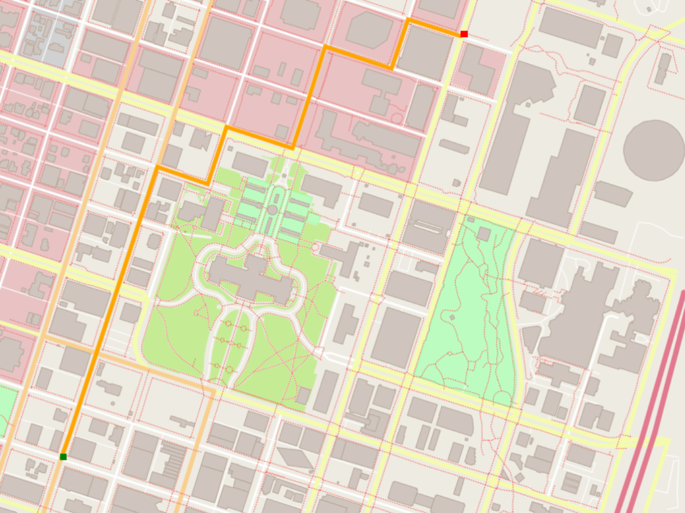

# RoutePlanner-AStar

A modern C++ pathfinding application that constructs road-network graphs from OpenStreetMap (OSM) XML data and calculates optimal routes using the A* search algorithm.

This project was developed as an undergraduate Data Structures and Algorithms portfolio project to explore real-world graph modeling, heuristic search, cost relaxation, and defensive graph traversal.



---

## Table of Contents

1. [Overview](#overview)
2. [Key Features](#key-features)
3. [How It Works](#how-it-works)
4. [Algorithm Deep Dive](#algorithm-deep-dive)
5. [Data Structures & Complexity](#data-structures--complexity)
6. [Project Structure](#project-structure)
7. [Dependencies & Requirements](#dependencies--requirements)
8. [Build Instructions](#build-instructions)
9. [Running Automated Tests](#running-automated-tests)
10. [Running the GUI Application](#running-the-gui-application)
11. [Limitations & Future Work](#limitations--future-work)
12. [Learning Outcomes](#learning-outcomes)
13. [License](#license)

---

## Overview

Finding the shortest path between two geographic coordinates is a classic problem in computer science. While textbook graph algorithms often operate on pre-constructed abstract adjacency matrices, real-world mapping applications must:

1. Ingest raw geographic markup (OpenStreetMap XML).
2. Filter navigable transportation infrastructure (excluding pedestrian footways, buildings, and natural boundaries).
3. Translate linear waypoints into an interconnected topological graph.
4. Snap arbitrary query coordinates to the nearest valid road nodes.
5. Execute an informed shortest-path search to find the optimal route.
6. Reconstruct the ordered path for visualization and metric distance calculation.

`RoutePlanner-AStar` demonstrates this complete pipeline in standard C++17, maintaining a clean separation between map data parsing, graph modeling, pathfinding logic, and 2D rendering.

---

## Key Features

- **OpenStreetMap XML Ingestion**: Parses raw OSM datasets via `pugixml` to extract geographic bounds, nodes, and highway ways.
- **Topological Road-Network Modeling**: Connects consecutive nodes along navigable road ways to form a faithful graph without artificial shortcuts across curved geometries.
- **A\* Shortest-Path Search**: Uses an admissible Euclidean heuristic to compute the shortest path efficiently.
- **Cost Relaxation & Node Reopening**: Correctly updates node costs and parent pointers when a cheaper alternative route is discovered, reopening nodes if necessary.
- **Defensive Path Reconstruction**: Safely backtracks through parent pointers with cycle detection and null-pointer guards to prevent infinite loops.
- **Decoupled Test Suite**: 16 automated GoogleTest unit and integration tests covering graph topology, edge cases, and real-map routing without requiring GUI or display libraries.
- **Optional 2D Map Rendering**: Visualizes the road network and computed route path using `io2d` and `Cairo`.

---

## How It Works

```
┌─────────────────┐       ┌─────────────────┐       ┌──────────────────────┐
│  OpenStreetMap  │  ───> │   RouteModel    │  ───> │     RoutePlanner     │
│    XML Data     │       │  (Graph Build)  │       │     (A* Search)      │
│   (map.osm)     │       │ node_to_road map│       │ Euclidean Heuristic  │
└─────────────────┘       └─────────────────┘       └──────────────────────┘
                                                               │
                                                               ▼
┌─────────────────┐       ┌─────────────────┐       ┌──────────────────────┐
│   Render / UI   │  <─── │ Metric Distance │  <─── │ Path Reconstruction  │
│  (io2d / Cairo) │       │   Calculation   │       │   (Cycle Detection)  │
└─────────────────┘       └─────────────────┘       └──────────────────────┘
```

### 1. OpenStreetMap XML Ingestion
The base `Model` class reads the `.osm` XML file into memory and uses `pugixml` to extract:
- `<bounds>`: The geographic bounding box (`minlat`, `minlon`, `maxlat`, `maxlon`) used to normalize all latitude and longitude coordinates into a unit interval $[0.0, 1.0]$.
- `<node>`: Geographic point locations with unique 64-bit OSM IDs and geographic coordinates.
- `<way>`: Ordered sequences of node references representing linear features (roads, footways, building contours).

### 2. Road-Network Graph Construction
`RouteModel` extends `Model` by wrapping base nodes into `RouteModel::Node` instances and constructing a fast spatial index:
- Filters out non-roadways (such as `Model::Road::Type::Footway`).
- Populates an inverted hash map (`node_to_road`: `std::unordered_map<int, std::vector<const Model::Road*>>`) that maps each node index to the road ways containing it.

### 3. Node and Edge Relationships
In OpenStreetMap, roads are represented as ordered lists of node references. An edge exists only between consecutive nodes along the same way:
- `RouteModel::Node::FindNeighbors()` queries `node_to_road` for the current node.
- For each associated road way, it inspects the immediate predecessor ($i - 1$) and immediate successor ($i + 1$).
- Only consecutive nodes along the way are linked as neighbors. Geometrically close nodes belonging to curved or parallel roads are **not** connected unless they share an explicit intersection node.

### 4. A* Search Execution
Given start and destination coordinates:
- `RouteModel::FindClosestNode` performs a spatial scan over all road nodes to snap input coordinates to the closest valid network nodes.
- The search expands outward from the start node, using a priority open list sorted by $f(n) = g(n) + h(n)$.

### 5. Path Reconstruction
Once the goal node is expanded:
- `RoutePlanner::ConstructFinalPath` traces `parent` pointers from the destination back to the start node.
- An `std::unordered_set<const RouteModel::Node*>` tracks visited pointers to detect and abort on cyclic chains.
- The path sequence is reversed into origin-to-destination order.
- Normalized path distance is scaled by `m_Model.MetricScale()` to report the true travel distance in meters.

---

## Algorithm Deep Dive

### Evaluation Function

$$f(n) = g(n) + h(n)$$

| Component | Meaning | Implementation in Source |
| :--- | :--- | :--- |
| **$g(n)$** | Exact accumulated cost from the start node to node $n$. | Stored in `RouteModel::Node::g_value`. Initialized to $\infty$ (`std::numeric_limits<float>::max()`); start node set to `0.0f`. |
| **$h(n)$** | Estimated cost from node $n$ to the destination node. | Calculated by `RoutePlanner::CalculateHValue` using Euclidean straight-line distance to `end_node`. |
| **$f(n)$** | Total estimated cost of the cheapest path constrained through node $n$. | Evaluated dynamically during node selection: `(v->h_value + v->g_value)`. |

### Heuristic Admissibility & Consistency

The heuristic uses the Euclidean straight-line distance in normalized coordinates:

$$h(n) = \sqrt{(x_n - x_{goal})^2 + (y_n - y_{goal})^2}$$

- **Admissible**: In a 2D Euclidean coordinate projection, the straight-line distance is the shortest possible path between two points. It never overestimates the true network distance ($h(n) \le h^*(n)$).
- **Consistent (Monotonic)**: By the triangle inequality, for any node $n$ and neighbor $n'$, $h(n) \le \text{dist}(n, n') + h(n')$. This ensures that node costs monotonically increase and guarantees optimal path discovery.

### Cost Relaxation and Node Reopening

During neighbor expansion in `RoutePlanner::AddNeighbors`:

```cpp
float tentative_g = current_node->g_value + current_node->distance(*neighbor);

if (tentative_g < neighbor->g_value) {
    neighbor->parent = current_node;
    neighbor->g_value = tentative_g;
    neighbor->h_value = CalculateHValue(neighbor);

    // Reopen node if it was previously closed
    neighbor->visited = false;

    // Add to open list if not already present
    if (std::find(this->open_list.begin(), this->open_list.end(), neighbor) == this->open_list.end()) {
        this->open_list.push_back(neighbor);
    }
}
```

If a cheaper route to an already-discovered neighbor is found:
1. Its `g_value` is updated (relaxed) to `tentative_g`.
2. Its `parent` pointer is redirected to `current_node`.
3. Its `visited` flag is reset to `false`, allowing re-evaluation if necessary.
4. If not currently queued, it is re-added to the open list.

### Open-List Implementation

In this codebase, the open list is implemented as an `std::vector<RouteModel::Node*> open_list`:
- Rather than maintaining an active binary heap or `std::priority_queue`, `RoutePlanner::NextNode()` sorts the vector in descending order of $f$-value via `std::sort` prior to extraction:
  ```cpp
  std::sort(this->open_list.begin(), this->open_list.end(),
            [](const RouteModel::Node* v1, const RouteModel::Node* v2) {
                return (v1->h_value + v1->g_value) > (v2->h_value + v2->g_value);
            });
  ```
- The node with the lowest $f$-value is extracted from the back via `pop_back()` in $O(1)$ amortized time.
- The extracted node is marked closed (`visited = true`).

---

## Data Structures & Complexity

| Operation / Component | Data Structure Used | Time Complexity | Space Complexity | Notes |
| :--- | :--- | :--- | :--- | :--- |
| **Node-to-Road Index** | `std::unordered_map<int, std::vector<const Road*>>` | $O(1)$ avg lookup | $O(V_{road} + E)$ | Built once during model initialization. |
| **Graph Adjacency** | `std::vector<Node*>` per node | $O(\text{deg}(v))$ expansion | $O(V + E)$ | Populated on demand; cached to avoid duplicate edges. |
| **Nearest Node Search** | Linear scan across road ways | $O(N_{road\_nodes})$ | $O(1)$ | Scans non-footway nodes to snap input coordinates. |
| **Open List Pop** | `std::vector` + `std::sort` | $O(K \log K)$ per pop | $O(K)$ | $K = |\text{open\_list}|$. Educational design choice. |
| **Path Reconstruction** | Pointer chain + `std::unordered_set` | $O(L)$ steps | $O(L)$ | $L = \text{path length}$. Set guards against pointer cycles. |

> **Complexity Note**: In classical A* implementations, a binary min-heap (`std::priority_queue` or Fibonacci heap) provides $O(\log K)$ node extraction. The vector sorting approach used here takes $O(K \log K)$ per expansion. While suboptimal for multi-million-node graphs, it is straightforward to debug, inspect, and verify for academic demonstration on regional city maps.

---

## Project Structure

```
RoutePlanner-AStar/
├── CMakeLists.txt              # CMake build configuration (test & GUI targets)
├── LICENSE                     # Project license (MIT)
├── README.md                   # Portfolio documentation & instructions
├── map.osm                     # OpenStreetMap XML dataset (Bhubaneswar, India)
├── map.png                     # Map rendering asset
│
├── cmake/                      # CMake find modules
│   ├── FindCairo.cmake         # Cairo library discovery module
│   └── FindGraphicsMagick.cmake# GraphicsMagick discovery module
│
├── src/                        # Core application & algorithm source code
│   ├── main.cpp                # GUI entry point, CLI parser, and event loop
│   ├── model.h / .cpp          # OSM XML parser and base geographic data model
│   ├── render.h / .cpp         # 2D map & route renderer using io2d/Cairo
│   ├── route_model.h / .cpp    # Graph node modeling & topological adjacency
│   └── route_planner.h / .cpp  # A* search algorithm & path reconstruction
│
├── test/                       # Automated testing infrastructure
│   └── utest_rp_a_star_search.cpp # 16 GoogleTest unit and integration tests
│
└── thirdparty/                 # Bundled third-party dependencies
    ├── googletest/             # GoogleTest unit testing framework
    └── pugixml/                # Lightweight C++ XML manipulation library
```

---

## Dependencies & Requirements

### 1. Automated Test Suite (Headless & Portable)
The test suite is fully decoupled from all rendering and GUI libraries:
- **C++ Compiler**: C++17 compliant (GCC 8+, Clang 7+, or MSVC 2019+)
- **CMake**: Version 3.10 or higher
- **pugixml**: Automatically uses bundled `thirdparty/pugixml` if not installed on host
- **GoogleTest**: Automatically uses bundled `thirdparty/googletest`

### 2. GUI Application (Optional)
The graphical interface requires additional 2D rendering libraries:
- **io2d**: Experimental C++ 2D Graphics Library (P0267 reference implementation)
- **Cairo**: 2D vector graphics library (`libcairo2-dev` on Debian/Ubuntu)
- **GraphicsMagick**: Image processing library
- **libpng**, **zlib**, **Iconv**

---

## Build Instructions

Always configure builds in an out-of-tree build directory to keep the source tree clean.

### A. Building the Automated Test Suite (Recommended)

The test suite builds on any standard C++17 platform without requiring GUI libraries:

```bash
# 1. Generate build configuration
cmake -B build -DCMAKE_BUILD_TYPE=Release

# 2. Compile the dedicated test executable
cmake --build build --target route_planner_tests
```

On multi-configuration generators (such as Visual Studio on Windows):
```powershell
cmake -B build
cmake --build build --target route_planner_tests --config Release
```

### B. Building the GUI Application

The GUI target `OSM_A_star_search` is conditionally enabled only when both `io2d` and `Cairo` are discovered by CMake. If missing, CMake outputs:
```
-- io2d not found; GUI target OSM_A_star_search will not be built. Tests remain fully functional.
```

#### Supplying Dependencies via vcpkg
If dependencies are installed via Microsoft's `vcpkg`, pass the toolchain file:

```bash
# Set VCPKG_ROOT or pass CMAKE_TOOLCHAIN_FILE explicitly
cmake -B build -DCMAKE_TOOLCHAIN_FILE="$VCPKG_ROOT/scripts/buildsystems/vcpkg.cmake"
cmake --build build --target OSM_A_star_search
```

> **Platform Note**: Building `io2d` can be challenging on modern Linux distributions and macOS due to deprecated C++ allocator dependencies. If GUI build dependencies are not available on your environment, the automated test suite provides 100% verification of the core graph and routing algorithms.

---

## Running Automated Tests

The test suite (`test/utest_rp_a_star_search.cpp`) includes 16 tests categorized into three functional areas:
1. **Graph Construction**: Consecutive adjacency, curved road preservation, intersection connectivity, duplicate edge prevention, and invalid node safety.
2. **A\* Algorithm & Cost Relaxation**: Shortest-path optimality, multi-path diamond networks, cost relaxation updates, grid traversal, identical start/goal endpoints, disconnected components, and cycle detection.
3. **Real Map Integration**: End-to-end routing on the real-world Bhubaneswar `map.osm` dataset.

### Running with CTest (Recommended)
CTest automatically executes with the repository root as its working directory, ensuring `map.osm` is located:

```bash
ctest --test-dir build --output-on-failure
```

For multi-config generators (MSVC):
```powershell
ctest --test-dir build -C Release --output-on-failure
```

### Running the Binary Directly
```bash
# Linux / macOS
./build/route_planner_tests

# Windows (Single-config or MinGW)
.\build\route_planner_tests.exe

# Windows (MSVC multi-config)
.\build\Release\route_planner_tests.exe
# or
.\build\Debug\route_planner_tests.exe
```

---

## Running the GUI Application

### Command Syntax

```bash
# Run with default map (expects ../map.osm relative to build directory)
./OSM_A_star_search

# Run with custom OSM map file
./OSM_A_star_search -f /path/to/map.osm
```

### Coordinate Input Format

The application prompts for four floating-point coordinates in standard input:
```
Enter start and end points (start_x start_y end_x end_y):
```

- **Format**: `start_x start_y end_x end_y`
- **Expected Range**: `0.0` to `100.0` (representing percentages of the map's geographic bounding box).
- **Coordinate Conversion**: The constructor scales input values by $0.01$ (`start_x *= 0.01f`) to map percentages to normalized $[0.0, 1.0]$ coordinate space.

#### Example Session (Bhubaneswar Map)

```text
Reading OpenStreetMap data from the following file: ../map.osm
Enter start and end points (start_x start_y end_x end_y): 10 10 90 90
Distance: 1253.42 meters.
```

An interactive window will display the rendered map with the calculated route highlighted.

---

## Limitations & Future Work

1. **Bidirectional Road Assumption**: OpenStreetMap one-way tags (`oneway=yes`) are not evaluated; all navigable highway segments are currently modeled as bidirectional edges.
2. **Distance-Only Edge Weights**: Edge costs reflect Euclidean physical distance only. Real-world routing factors such as speed limits (`maxspeed`), traffic signals, road hierarchies (motorway vs. residential), and elevation are not modeled.
3. **Linear Open-List Sorting**: The open list sorts an `std::vector` on each expansion ($O(K \log K)$) rather than using an indexed min-heap ($O(\log K)$) or bucketed priority queue.
4. **Linear Nearest-Neighbor Search**: `FindClosestNode` iterates over all road nodes ($O(M)$) to snap coordinates. A spatial partitioning structure (such as a k-d tree or R-tree) would reduce this to $O(\log M)$.
5. **Turn Restrictions**: Complex real-world constraints such as prohibited left turns, lane assignments, and U-turn bans are not supported.
6. **GUI Portability**: The `io2d` rendering layer relies on an unadopted C++ technical specification with limited ongoing compiler support.

---

## Learning Outcomes

This project demonstrates practical mastery of core Data Structures and Algorithms concepts:

- **Graph Abstraction**: Transforming semi-structured hierarchical XML documents into a formal graph $G = (V, E)$.
- **Heuristic Design**: Formulating an admissible, monotonic heuristic function ensuring algorithm completeness and optimality.
- **Dynamic Programming & Relaxation**: Applying edge relaxation principles to update parent references and minimum distance estimates during search.
- **Defensive Systems Programming**: Guarding against malformed external data, missing node IDs, cyclic pointer chains, and null dereferences.
- **Automated Testing & Modularity**: Architecting decoupled software components so core algorithms can be rigorously validated via automated test suites independently of graphics drivers.

---

## License

This project is licensed under the MIT License. See the [LICENSE](LICENSE) file for details.
